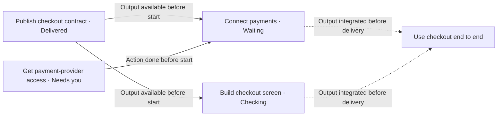

# Make autonomous work understandable

Proposal, November 13, 2026. Grounded in installed app 0.6.0 / workflow 1.4.1 and commit `8d0affa`. This pass produces a product and implementation plan. The user subsequently authorized foundation slice 0 with “do it”. Foundation slice 0 is delivered locally in app 0.7.0 / workflow 1.5.0; later slices remain proposals. See [foundation implementation and verification](dependency-assessment-foundation.md).

## Product intent

Let a person give agents a goal, continue working in their existing chats and runner tools, and use Work Inbox to understand progress, relationships and meaningful interruptions. Agents should recover the same intent and evidence across retries and handoffs.

Work Inbox owns the shared record of intended outcomes, work relationships, decisions, reported progress and output evidence. The runner owns execution: prompts, models, tools, workspaces, scheduling, retries, budgets and stopping. A runner can use Work Inbox's records to inform its decisions; recording work or acquiring a cooperative claim grants no execution authority.

Keep one change for a bounded useful output. Many turns, agents, review passes and attempts can contribute to it. Create a feeding stream when it represents a useful sub-outcome, and a separate change when it produces a separately meaningful output. A retry or tool call alone does not create another work item.

## What exists and what is missing

| Need                         | Existing foundation                                                                                                                               | Proposed addition                                                                                                 |
| ---------------------------- | ------------------------------------------------------------------------------------------------------------------------------------------------- | ----------------------------------------------------------------------------------------------------------------- |
| Retain the goal and approach | Stream outcome/constraints/context, change objective/expected output/acceptance criteria, structured decisions/findings                           | Reuse these fields and guidance; avoid a second plan or policy engine                                             |
| Describe related work        | Parent streams; typed start/delivery prerequisites across streams, changes and human actions; unknown/current/stale assessment                    | Add explicit question prerequisites; improve focused hierarchy and branch presentation                            |
| Coordinate participants      | Revision checks, cooperative claims, exclusive resource names                                                                                     | Associate reported attempts with their work and source; retain advisory claim limits                              |
| Recover across chats         | Explicit project/default/per-chat selection, sessions/turns, lifecycle hooks, transactional checkpoints, private outbox, replay/conflict handling | Fence work association across topic changes and expose activity/freshness separately from work progress           |
| Understand iterations        | Progress notes, history and output reports                                                                                                        | Lightweight attempt records with optional coarse phase and iteration; a separate record for verification evidence |
| Understand human needs       | Explicit questions/actions, opt-in attributed chat responses, optional validated chat links, impact rollups                                       | Connect a question to the work it blocks and preserve exact request identity through retries                      |
| See the work                 | Selectable Map/List, feeding-stream groups, real edges, delivered context, bounded projection and independent history paging                      | Activity/freshness overlays, branch focus and restrained aggregation, with equivalent list information            |

Current gaps matter: `workflow_sessions` measures chat synchronization, not running execution; `Stop` means an assistant turn ended. `change_meta.progress=working` is an agent report. Output availability/integration is reported, not observed from Git. Questions appear in the map but are not valid prerequisite sources. Current conditional support is prerequisite gating, not arbitrary branching logic or mutually exclusive alternatives. Dependency fingerprints already detect changes to selected work, its ancestors and recorded sources; they do not certify that the agent reviewed the surrounding work inventory or supplied an explanation for an empty prerequisite set.

## Minimal product model

Keep four concepts separate:

1. **Work:** the stable outcome and its reported progress, constraints and prerequisites.
2. **Attempt:** a source's bounded pursuit of one change. An attempt can span several turns; a new retry or replacement run can begin another attempt. A chat can contribute to several changes through separate associations.
3. **Evidence:** the output and verification reports supporting the work, attached to the relevant version.
4. **Request:** an exact question or human action and the work that waits for it.

Do not derive work delivery from an attempt ending, an exit code, a released/expired claim, silence, a topic change, or a human request being answered. Do not close a stream when its current changes are delivered.

### How an agent uses the record

At the start of an attempt, retrieve the selected work's compact context: outcome and brief approach, current scope/plan, prerequisite reasons and assessment, unresolved request IDs, recent output/check evidence and handoff. Reuse the current bounded context retrieval, fetching full records only when relevant. The agent or runner chooses its work; Work Inbox must not quietly select a next task or treat every ungated item as safe to run.

The participant assesses prerequisites against the version it read, cooperatively claims its selected change where applicable and records an attempt. Its own runner then implements, checks and revises. At meaningful boundaries it saves a short checkpoint, applicable evidence and any exact request. A restart or replacement agent recovers that same change and the latest useful finding instead of repeating an unsuccessful approach or creating duplicate work. Fresh upstream output or scope invalidates the old assessment as it does today; a retry cannot simply reuse an unread assessment.

The report response should acknowledge what was saved and return current selection/version, unresolved requests and any stale/conflicting state. Queued is not saved, and an ended attempt is not a request to dispatch another one. This compact exchange is the integration contract; detailed execution checkpoints stay with the runner.

### Required dependency information

User requirement, November 13: agents must explicitly report how work depends on other work, including when it has no identified dependencies. Make this a required reporting contract, supplied through shared guidance and enforced through structured API validation. An empty edge list on its own does not satisfy it.

For each selected change or stream, assess **starting** and **delivering** separately. Each stage records one of:

| Assessment                 | Required report                                                                              | Meaning                                                                        |
| -------------------------- | -------------------------------------------------------------------------------------------- | ------------------------------------------------------------------------------ |
| Dependencies identified    | Exact prerequisite IDs, start/delivery stage, required condition and a short reason for each | The recorded output, outcome, answer or action must meet the named condition   |
| No dependencies identified | Explicit `none` declaration and a brief rationale within the reviewed scope                  | The agent reviewed related work and identified no prerequisites for that stage |
| Uncertain                  | What remains unknown and the next step to resolve it                                         | Assessment was attempted, but independence/readiness has not been established  |

Unassessed is the absence of that report. Freshness (current/stale) is separate from its result. A current report may still say uncertain. “All recorded prerequisites satisfied” also remains separate from “the assessment is complete”.

For example: “The settings layout can start independently of the connection-service change because it uses the existing interface; delivery requires that change's available output for the new connection indicator.” That yields no start prerequisites and one explicit delivery gate. It does not claim that all work everywhere is independent.

Record who assessed it, the reviewed stream/branch scope and relevant work IDs, the scope/inventory version read, and the plan/prerequisite fingerprint. The server supplies actor/time attribution. A bounded context page is not a complete review: fetch remaining relevant work, or explicitly record a partial/uncertain assessment. Review related branches and cross-stream prerequisites when relevant; do not require every possible pair of work items to have an “independent” edge. Independence is a scoped assessment, not a second dense graph.

Save plan/edge changes first, then assess the resulting context, retaining today's fingerprint conflict rule. Reject a complete assessment if required stage results/reasons are missing, it contradicts its recorded gates, or it references an unread/stale scope version. Adding/reorganizing work or materially changing its expected output in a reviewed scope must trigger reassessment when it can affect that declaration. Routine notes, heartbeats and check logs should not invalidate every assessment. Extend the current fingerprint with the relevant reviewed inventory/version; it currently has no surrounding-inventory guarantee. Handle a race between review and report as a conflict, not a silent certification.

The managed begin-implementation/preflight path requires a complete, current assessment with no unresolved stage result. Existing prerequisite conditions still decide which start/delivery gates are satisfied; this data check grants no execution authority. Planning and explicitly observational reporting remain available while relationships are uncertain. A rejected or incomplete report gives the agent a specific repair instruction; it does not create a human approval chore. Older clients/history may continue reporting through compatibility paths but remain incomplete under the richer contract until explicitly reassessed; never migrate missing data to an assertion of independence.

Show short, distinct relationship states in Map/List and the inspector: dependencies recorded, no prerequisites identified, unassessed, uncertain, or needs rechecking. Put rationale, assessed scope and attribution in detail. Draw arrows only for actual prerequisites; do not invent arrows for independence. An unlinked node or branch layout must never visually imply that assessment is finished or that parallel edits are safe. Shared files/resources and cooperative claim conflicts remain separate coordination facts.

Work Inbox can enforce completeness, consistency and freshness of the submitted information. Whether a dependency was correctly identified remains an attributed agent assessment; the app cannot discover omitted real-world constraints merely by validating a schema.

### Attempt and association contract

Add a small `work_attempts` model alongside the existing chat synchronization model. The existing `runs` table belongs to the optional simulated execution/review protocol; it must not become a production scheduler by being repurposed.

An attempt needs a change ID, a server ID, an optional source-provided external ID, reporting connection/actor, optional native session/chat reference, state, timestamps and a short current summary. State can be `active`, `waiting` or `ended`; ended attempts carry an explicit reason such as finished, interrupted, failed, cancelled, superseded or limit reached. An optional coarse phase (implementing/checking/revising) and iteration counter are detail, not workflow topology. Requests and dependency waits are references when known, rather than duplicated prose.

Use source/connection-scoped external IDs to recover an attempt after a lost response. Every mutation carries an idempotent event ID and expected version or monotonic source sequence. Reject reused event IDs with different content. Keep server receipt time separate from reported occurrence time; delayed events must not revive an ended attempt or replace newer state. Reopening an ended attempt requires a new attempt ID.

Persist events through the existing outbox/replay pattern. Retain a bounded summary and paged compact history; do not ingest transcripts, every tool call, model reasoning or full test logs. Link to external detail where supported. Several sources can report attempts for one change; retain each source's state rather than letting the last arrival erase other activity. The first native adapter only needs one writer association; reviewers can attach attributed findings/evidence without gaining the writer's claim.

Pin each attempt to explicit work IDs. A selection change increments a server-recognized association generation (or equivalent opaque fence). New checkpoints carry that association. A queued checkpoint for the old selection cannot land on new work. A late terminal event may close its own old attempt, but cannot update the new selection's work. Parallel agents use separate associations. A claim ID is a reference, never a replacement for its private credential/session/token checks.

Preserve current bindings during implementation/migration. Improve the agent-facing select/recover operation and make association confirmation part of its result. A stream-only selection supports discussion/planning; it does not invent a change or attach everything to the old validation pilot. The agent must explicitly select or create the relevant bounded change before reporting change activity. A missing selection or conflicting association remains explicit. A delivered default change supplies historical context until the agent explicitly selects or creates current work; a new prompt must not silently reopen it. Reopening requires explicit intent and a note.

### Activity, progress and freshness

Show activity and work progress as separate facts. An adapter states which signals it can provide. Existing native turn hooks alone do not establish that a background execution attempt started or ended. Initially, attempt boundaries may be explicitly agent-reported; label that capability honestly. A runner with real run events can later supply those boundaries mechanically through the same contract.

Keep `lastReceivedAt` separate from `lastMeaningfulProgressAt`. Only claim live activity when a source supplies a documented liveness signal with a freshness window. Chat-only sources show “Last reported checking” and a timestamp. Missing heartbeats mean “Activity unknown” or “Updates unavailable”, not “Failed”, “Delivered” or “Needs you”. A pending count describes the client's last report, not a live view of its offline queue.

The runner enforces iteration/time/cost limits and reports why it stopped. Work Inbox may display “Stopped after repeated test failures” or “Runner limit reached”, with evidence and affected work. Raising a human request is a separate explicit action. Expensive or repeated activity alone must not manufacture a decision for the user. Only a reported, actionable exception belongs in Needs you.

Quiet parking remains part of the existing everyday-sync direction, not an automatic inference from a stopped attempt. This plan does not silently add a new Parked lifecycle state or reopen/finish old work.

### Verification evidence

Reuse acceptance criteria and output records. Add lightweight, attributed verification reports when attempting/checking work: a short check label, passed/failed/inconclusive result, source/actor, attempt ID where available, optional evidence link, timestamp, and the work/plan/artifact version actually checked. A code revision or equivalent output revision anchors artifact checks. Missing version information remains unversioned evidence, not a current passing result.

Pin relevant work and plan revisions (including material stream scope) independently of progress-note counters. A later artifact or material plan change makes the earlier report historical. A passing check speaks only for that check; it is not proof that all acceptance criteria passed. Multiple reviewers' reports retain their source and disagreements.

A finished attempt can coexist with a failed check, missing output or undelivered change. Delivery remains an explicit attributed work report. Guidance requires describing what was verified and any material gaps; the UI must not label an agent-reported pass as independent verification. Legacy records show “Verification not recorded” in detail, without adding human review chores or a compulsory approval gate.

### Questions that unlock work

Extend prerequisite **sources** to include a human-directed question, with an `answered` condition. Targets remain streams or changes. Satisfaction requires a recorded answer on that question; superseding or withdrawing it is not an answer. Do not reuse “outcome accepted” or create an approval object for this.

Reuse the question ID, revision, optional conversation URL and existing owner/opt-in chat-relay response rules. The answer is attributed to its actual source; an agent cannot silently answer on behalf of the human. Cross-stream requests retain their owning stream and exact selection checks. If a chat is on another branch, select/retrieve the request's own context before relaying its response rather than broadening permissions.

Update graph validation, assessment fingerprints and impact rollups for question sources. Backfill node identity for existing human questions if needed, preserving their states and answers; never infer links from their text. One request waiting on several outputs appears once in Needs you with its direct unlocks, and its affected branches remain visible in the map. Open questions without a known dependency remain visible without an invented edge.

## Visualization contract

The main map represents outcomes and prerequisites. A change's internal implement/test/review loop appears as concise activity within that node and optional attempt/evidence history in its inspector. Do not draw retries as dependency cycles or a new card for every iteration. Existing legitimate stage-dependent work relationships remain valid.

Illustrative example only; these records are not added to the live inbox:

The human sees that access blocks payments while the screen can keep progressing. Selecting access highlights its direct unlock and the downstream impact with that distinction labelled. Selecting the screen shows its latest check and evidence. Its internal retries stay underneath the same change.

Presentation rules:

- Keep the current compact header, Map/List switch and immediate visible work. Use the current tokens, typography, keyboard focus, reduced-motion and native link allowlist.
- Groups describe feeding streams. Their position expresses hierarchy, not prerequisites. With multiple levels, show parent context and focus a child branch through breadcrumbs. Introduce summary groups/collapse only with explicit counts and hidden-work indication; preserve selection and a direct way to expand. Delivered work is quieter; it must remain findable/selectable.
- Lay out recorded prerequisites to reduce crossings while tolerating stage-valid loops and external references. Avoid drawing links through unrelated nodes. Keep the current deterministic layout initially; adopt a layout dependency only if branch fixtures demonstrate a material readability benefit.
- Solid links mean start gates; dashed links mean delivery gates. Repeated attempts are never represented by these lines. Satisfied links stay visible and quieter. Distinguish direct edges from derived downstream impact in the inspector; do not turn transitive impact into stored direct edges.
- A compact phase can explain current movement: “Checking checkout”, “Revising after review”. Iteration counters, attempt IDs, lease data and raw evidence are secondary. Use color to support text: blue for reported activity/selection, amber for waits/real human needs, neutral for delivered context. A green live indicator requires fresh source liveness, not a connected MCP credential.
- Keep work status, verification and freshness independent. A delivered node with an old report is still delivered; an old “working” report must not appear live. Unknown/stale dependency assessment stays distinct from stale activity. No links means unassessed/unspecified relationships unless explicitly assessed; adjacent nodes are not automatically independent or conflict-free.
- Roll stream summaries up from factual child state: moving branches, waiting branches, delivered outputs and deduplicated human requests. Avoid a percentage based on equal-weight item counts. Do not automatically close a parent or generate a new human request from rollups.
- A request names the exact ask and immediate consequence, optionally linking to chat. Answering elsewhere resolves the same request. No accept/decline controls, routine sign-offs, retry/resume buttons, or new workflow builder.
- Keep identical relationship/activity information available in List and the inspector. Retain bounded projection warnings, linked references, narrow-screen behavior and independent history pagination. Hidden/truncated relationships cannot be presented as a complete plan.

## Implement in small increments

These are proposed slices, not newly scheduled implementation work. The existing **Keep Work Inbox in sync during everyday work** (`89963e46-3deb-4f29-af83-d16ea8aaccba`) remains the starting implementation item. Preserve its broader closeout/parking and real-client validation requirements; the first slice below is a bounded part of it. Do not reopen the delivered map change or revive the older approval-centric proposal.

| Slice                                     | Useful result                                                                                    | Scope and likely files                                                                                                                                                                                                                                                                            | Acceptance boundary                                                                                                                                                                                                                                       |
| ----------------------------------------- | ------------------------------------------------------------------------------------------------ | ------------------------------------------------------------------------------------------------------------------------------------------------------------------------------------------------------------------------------------------------------------------------------------------------- | --------------------------------------------------------------------------------------------------------------------------------------------------------------------------------------------------------------------------------------------------------- |
| A. Associate activity with the right work | Normal chats and runner reports stay attached to the right change; old activity cannot look live | Add a small migration, shared activity contract and service; extend `shared/sync.ts`, `services/sync.ts`, `workflow/hooks.ts` and outbox/helper/MCP operations; add a compact activity/freshness projection to `services/work-map.ts`, `shared/work-map.ts`, `WorkMap.tsx` and relevant work rows | Explicit association, idempotent begin/checkpoint/end, fenced reselection, attempt ending separate from delivery, old clients still work, stale/offline display. Validate first with one supported local client; label agent-reported boundaries honestly |
| B. Connect questions to what they unlock  | A decision in chat clears the exact waiting branch                                               | Extend source/condition schemas, `services/flow.ts`, question persistence/node identity, assessments, attention/impact and map/inspector                                                                                                                                                          | One question gates multiple changes across branches; exact attributed answer resolves the same ID; superseded question stays unsatisfied; direct/transitive impact and counts are correct                                                                 |
| C. Preserve verification across retries   | “Checked” is tied to the actual output and plan                                                  | Add bounded verification storage/service/API/MCP wrappers using the same attempt and output references; extend checkpoint transactions; show current/historical evidence in the inspector                                                                                                         | Duplicate reports replay, old artifact passes remain historical, conflicting reports retain attribution, failed/ended attempt cannot mark delivery, no approval gate or invented historical checks                                                        |
| D. Make larger streams easy to follow     | Several feeding streams remain understandable as they grow                                       | Focus/aggregation and optional layered layout in the existing map projection/component; keep List and accessibility equivalents                                                                                                                                                                   | Fixture with several levels and cross-branch links, human blocker on one branch and activity on another, quiet delivered context, stable selection and truthful partial-view indication                                                                   |

**Foundation slice 0: require explicit dependency assessments.** Extend the current assessment model/service rather than adding another graph store: per-stage result and rationale, reviewed scope/inventory version, fingerprint checks, context/tool guidance and complete/current preflight validation. Include the small Map/List distinction between unassessed, assessed-none, linked, uncertain and stale. A plain empty edge set remains unknown. Keep old records/protocols readable without manufacturing assessments. Likely files: `shared/{streams,oversight,work-map}.ts`, `services/{flow,streams,stream-data,work-map}.ts`, the claim/attempt preflight path, MCP/workflow guidance, and `web/src/WorkMap.tsx`, plus a small migration. Human actions and later question sources use the same typed gate contract.

**Revised implementation order:** foundation slice 0 first, then slice A end to end, including its small map/list activity overlay. Slice 0 provides useful graph clarity on its own; A addresses everyday synchronization using that reporting foundation. Treat both assessment and attempt contracts as shared APIs before building integrations against them. Slice B is independently useful and does not depend on attempt execution or verification. Slice C consumes A's stable attempt contract. D can start against explicit fixtures; the final overlays consume the relevant assessment/activity/evidence projections. These are delivery dependencies, not a claim that every later slice must wait sequentially for all earlier work.

Avoid a large public runner SDK initially. Ship one versioned reporting contract, thin authenticated MCP/API wrappers around the shared service and an adapter capability report. Reuse the current protected local credential and loopback deployment. A reporting bridge does not automatically enable remote webhooks, hosting or a worker. Support one real client completely before advertising another. Preserve unrelated hooks/skills/Herdr setup and distinguish installation, trust, observed event delivery and reported activity.

## Acceptance scenarios and release checks

1. **Ordinary work:** two real streams and several changes in one chat; explicit selection follows intent and discussion-only turns do not automatically create implementation work. No content lands on the old validation pilot by default. Work is never inferred from a repository path alone.
2. **Recovery/races:** duplicate event, lost response, app offline, queued old checkpoint, out-of-order end/progress, overlapping helper calls, client restart/compaction and reselection. Old work retains history without overwriting the new association. Rejected/queued is visibly different from saved.
3. **Loop:** one change is implemented, checked, revised and checked again across more than one attempt. It stays one change. The latest applicable evidence is visible, older evidence remains historical, and only an explicit delivery report changes delivery.
4. **Parallel branches:** an answered question or completed human action unlocks one branch; an unrelated branch continues. Repeated attempts do not create duplicate requests. Current assessment, prerequisite satisfaction and cooperative claim availability remain separate facts; none guarantees safe parallel edits.
5. **Failure and freshness:** a runner reports a limit/failure, loses its heartbeat, or merely ends a turn. Each has the correct distinct display. No fabricated completion, automatic rerun or human request follows. A plain MCP/chat source never claims a live heartbeat it cannot provide.
6. **Version drift:** acceptance criteria, stream scope, dependency evidence or output code revision changes during verification. Preserve previous reports, conflict stale writes and avoid a current “passed” claim for the unread/new version.
7. **Presentation:** Map/List agree, selection and child focus survive polling, links avoid unrelated cards, direct versus downstream impact is explicit, keyboard/narrow layouts work, and truncation/paging remains truthful. Illustrative fixtures are isolated from user data.
8. **Compatibility/security:** old bindings/checkpoints still load; read/write scopes, opt-in exact feedback relay, claim credentials and safe URL rules remain intact. Source labels are attribution, not independent verification. No transcript or credential values enter work records, adapters or queues.
9. **Required relationship data:** reject incomplete complete-assessment reports; distinguish a missing edge set from explicit assessed-none with rationale. Exercise a change with no start gates but a delivery gate, a current uncertain assessment, and a legacy record without an assessment. Missing data gives the agent a repair instruction and no new Needs you item.
10. **Assessed independence and scope drift:** record no prerequisites within a reviewed scope; add relevant related work, change a shared interface, or alter scope before submission and require conflict/reassessment. A truncated review cannot claim full coverage. Independently assessed branches stay unconnected; shared-resource conflicts still prevent promising safe concurrency. Routine progress-note updates do not unnecessarily invalidate the assessment.

Run meaningful service/API/MCP/migration tests for each changed contract, browser checks for that slice, and packaged native checks before installing. For adapter claims, observe the real client lifecycle and label unsupported events rather than treating a helper invocation as proof. Back up app/data/guidance and compare preserved existing records and protected settings before post-install reporting writes. Keep earlier release evidence distinct from new checks.

## Deliberate limits and later options

Execution and retry policy, automated resume, workspace isolation, cost enforcement, dispatch, arbitrary conditional workflows, trace collection, SCM observation and hosting remain external or later work. Work Inbox records available evidence and requests; it does not decide the user's priorities or how much risk to take. A recorded graph cannot prevent agents outside the protocol from editing the same repository.

Automatic backups/recovery controls and the already discussed quiet parking behavior remain separate personal-version work. Framework-specific resume links, richer execution traces and plan versioning can follow demonstrated use; they are not prerequisites for slice A. No subscriptions, new approval system or workflow designer is introduced.

## References and source audit

The source audit covered `shared/{streams,sync,oversight,work-map}.ts`, `services/{streams,sync,flow,oversight,work-map}.ts`, `workflow/hooks.ts`, `web/src/WorkMap.tsx`, and the existing [synchronization](synchronization.md) and [map implementation](stream-work-map-plan.md) documents. The older [planning proposal](planning-and-decisions-plan.md) is explicitly superseded for approval policy.

External patterns inform this proposal; no framework integration has been validated here. Anthropic describes [parallel/delegated work, evaluator loops, environmental feedback and stopping limits](https://www.anthropic.com/research/building-effective-agents), and [durable progress, incremental work and end-to-end checks across agent sessions](https://www.anthropic.com/research/effective-harnesses-for-long-running-agents). LangGraph documents [graph execution and persistence](https://docs.langchain.com/oss/python/langgraph/overview) and [explicit interruption/resumption](https://docs.langchain.com/oss/python/langgraph/interrupts). Reviewed November 13, 2026. Work Inbox's work graph remains separate from those execution graphs.
