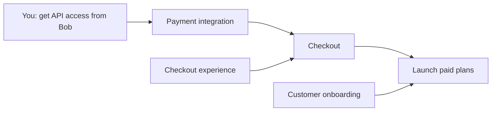

# Stream-first human oversight

Status: agreed product direction, November 11, 2026; implementation not started. The user has chosen stream-level approval for routine work within scope and agreed with this presentation/model direction. The current application has not implemented that policy, nested streams, or human-action dependencies yet.

The [implementation plan](stream-oversight-implementation-plan.md) defines the first slice, compatibility rules, delivery sequence, and acceptance checks.

## What the human needs to see

The primary questions are: what outcome is moving forward, what has actually been delivered, what is waiting, and what can I do to unblock it? Individual changes and MRs remain available for inspection, but they do not each earn a place in the attention queue.

The user explicitly chose that approving a stream's direction should allow agents to maintain routine changes within that scope without individual acceptance. Attention should go to decisions, human blockers, and scope changes. The application continues to store and present work; agents continue to plan and execute it.

## A small model at different scales

- **Stream:** an outcome and its current context. A stream can contain smaller streams. There are no separately named epic/story/task levels and no required depth.
- **Change:** a bounded, reviewable output, often an MR. Changes live under the relevant stream and normally remain collapsed in the human view.
- **Human action:** a concrete request for non-agent input or action, with an owner, completion condition, status, and links to what it unblocks. Examples include obtaining access, choosing a direction, supplying a document, or coordinating with another person.

An unresolved question and a human action are different. A question needs an answer; an action needs something to happen. Both may need human attention. They should remain distinguishable in the same attention view.

Agents raise human requests through MCP; the human answers or records the action's outcome in the UI. This does not require reintroducing a general work-creation form.

## Composition and dependencies

Two relationships must stay separate:

1. **Contains/contributes to:** where a stream belongs and how its outcome contributes to a larger outcome. Start with one parent per stream so navigation and rollups are understandable.
2. **Depends on:** what must be available before another part can proceed. These links can cross the containment tree; a stream's output can feed several other streams.

This gives the human a simple expandable hierarchy while preserving the actual network of prerequisites. Reject containment and impossible dependency cycles separately. Do not force shared prerequisites into duplicate streams just to make a tree look tidy.

In this example, one human action blocks payment integration, which holds up checkout and contributes to the launch outcome. Customer onboarding can continue. The launch stream should show partial blockage and its cause, rather than implying that all work has stopped.

Human actions need a stable identity, concise request, responsible person, optional waiting-on party, clear completion condition, and explicit blocked stream/change references. One action can unblock several branches. Count that action once in ancestor summaries and the global attention view.

Distinguish direct blockers from downstream impact. Show recorded relationships, not an invented schedule or an assertion that every dependent will immediately finish when an action is resolved. Keep implementation and integration gates distinct where relevant.

## Presentation

**Streams** becomes the normal overview. Each row/card should show the outcome, a concise evidence-based progress summary, the portion currently moving or waiting, and human attention if needed. For example: “Sandbox checkout works; production access is pending. One action needs you.” Child streams expand underneath; routine changes sit one level further down.

**Needs you** is the attention view. It contains pending direction/scope decisions, questions needing an answer, human actions, and outcomes explicitly requesting human review. For each item, show the action or decision first, then the immediate unlock and the larger affected stream. Routine notes, progress updates, and ordinary MR creation stay out of this queue.

**Stream detail** presents:

1. Outcome, constraints, and current progress.
2. Human input needed, with the dependency path and expected unlock.
3. Feeding streams: what is delivered, moving, waiting, or still unassessed.
4. Delivered outputs and meaningful recent developments.
5. Expandable changes, individual reports, and full activity history.

Use a readable tree/list by default. Offer a focused dependency view when opening a blocker or asking what it affects; avoid making a large graph canvas the only way to navigate the product.

Progress should describe achieved outcomes and remaining gates. Counts of changes are inventory, not a completion percentage. Use a milestone/checklist fraction only when those milestones are explicitly defined. Keep reports attributed and freshness visible in detail. A parent stream does not automatically complete when its currently planned children finish.

## Approval and attribution

The new policy is a deliberate change from the current “every new change enters Inbox” rule:

- New top-level direction and material scope expansion need a human decision.
- Routine decomposition and changes inside approved scope are recorded under that stream's approval, without individual acceptance chores.
- Preserve the approving stream/scope revision and source of that coverage. Do not fabricate an individual human acceptance event for each change.
- Agents cannot grant owner authority, change the approval policy, or silently broaden the approved outcome through metadata.
- The app validates explicit approval coverage and relationships; it does not judge the semantic quality of a plan or independently decide whether an agent's scope assessment is correct.
- Existing work and historical human decisions remain intact. No bulk retroactive acceptance of legacy proposals during migration.

The exact implementation of inherited approval for child streams needs to preserve these boundaries. Human-action completion and agent reports about prerequisites must retain their respective provenance.

## Implementation implications

This requires model and protocol changes alongside the presentation: recursive stream composition, human actions as dependency sources, stream/change dependency targets, deduplicated impact summaries, and explicit stream-level approval coverage. Moving existing cards around would leave both the attention overload and the missing human blockers unresolved.

Build a useful vertical flow first: an approved outcome with two feeding streams, an agent-raised human action that blocks one branch, an attention item showing the upstream impact, and a human response that updates those relationships. Keep the other branch visibly moving. Routine changes must stay out of the attention queue throughout that flow.

Validate with real development work as it becomes available. Design examples belong in prototypes/tests, not as unsolicited sample work in the user's live Inbox.
