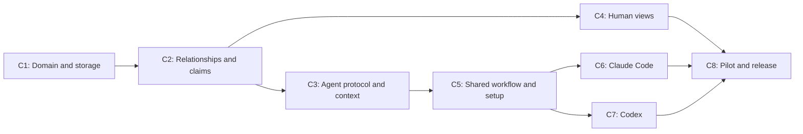

# Streams and agent workflows

Status: proposed implementation plan, November 11, 2026. This records the product direction agreed in conversation. No implementation, client configuration changes, or new work submissions are part of this planning change.

## Product intent

Work Inbox is durable working memory for agents and a clear interface for the human to understand their work. Agents plan, decompose work, choose what to tackle, and collaborate. The app records their understanding and activity, preserves context, and provides dependable coordination primitives.

The app validates data and permissions. It does not choose agents, generate plans, rank the best next action, launch execution, infer that work succeeded, or resolve code conflicts.

Two visible concepts:

- **Stream:** a sustained effort toward a specific outcome, spanning weeks or months. It carries intent, scope, current context, decisions, and open questions. Its delivery plan evolves as work uncovers new information.
- **Change:** a bounded piece of work producing a reviewable output, usually an MR. It can exist before a branch/MR and can retain replacement or additional output links. Documents and research findings are also valid outputs.

Sessions, claims, and attempts are supporting records, not another planning hierarchy. Delivering all currently planned changes does not automatically achieve or close a stream.

Work continues to originate externally. The human UI is for understanding, decisions, clarification, and review; it has no Jira-style creation form.

## Existing foundation and compatibility

Keep TypeScript, Fastify, SQLite/Drizzle, React, the stdio MCP bridge, and the native Mac window. There is no execution worker in normal use, and this plan does not enable one.

The existing `work` record is the starting point for a change. Add stream membership and structured metadata incrementally rather than replacing the work/assignment/event model. Preserve IDs, history, protected credentials, existing MCP configurations, and standalone work. Existing records start with no stream and unknown dependency assessment; they are not silently classified or assigned a fabricated outcome.

Retain `create_work`, `list_work`, `get_work`, and `add_work_update` for existing clients. Creation still enters Inbox and cannot be routed elsewhere by an agent. New protocol capabilities are additive and versioned. Use new SQL migrations and preserve the source/desktop deployment paths.

## Information model

These are contract requirements; exact table and tool names are finalized in the first slice.

| Record                      | Information to retain                                                                                                                                  |
| --------------------------- | ------------------------------------------------------------------------------------------------------------------------------------------------------ |
| Stream                      | Title, intended outcome and success evidence, scope/constraints, active/paused/closed lifecycle, current context, revision, provenance                 |
| Change                      | Existing objective/criteria plus optional stream, expected output, source, affected repositories/areas/resources, reported progress and blockers       |
| Dependency                  | Predecessor and dependent, implementation/integration stage, required condition such as output available or integrated, rationale, assessment revision |
| Context entry               | A decision, finding, question, or constraint; author/source, time, status, and superseded entry where applicable                                       |
| Output                      | Kind, link, relevant branch/commit or artifact revision, reported state, evidence, source, and observation time                                        |
| Collaboration session/claim | Agent connection, session identity, explicitly selected change, lease, reported activity, known context/code revisions, handoff references             |
| Project/workflow setup      | Explicit project binding, integration/workflow version, scoped managed files, verification results, last observed context retrieval                    |

Keep a concise current context alongside append-only history. Decisions and questions have explicit resolution/supersession, so agents do not need to infer current truth from months of notes. Full transcripts are not the default storage or context payload.

Distinguish ordinary record revisions from scope/plan revisions. Notes, heartbeats, and formatting corrections should not invalidate an entire dependency assessment. Changes to relevant scope, prerequisites, or upstream output revisions should make the affected assessment visibly stale.

### Dependencies and parallel work

- Capture implementation prerequisites separately from integration prerequisites. Starting work against a contract/branch can be possible before its MR merges.
- Record dependency assessment explicitly. Unknown and assessed-with-no-dependencies are different states.
- Derive descriptive prerequisite views from recorded conditions and their evidence. An agent's readiness assessment remains attributed to that agent; the app does not certify conflict-free execution.
- Record affected areas and explicit shared/exclusive resources. File overlap is a useful signal, not a proof of dependency or independence.
- Allow relationships across streams. Grouping work and ordering work are separate concerns.
- Reject missing references, self-dependencies, and impossible prerequisite cycles. Validate stage-specific gates so legitimate implementation/integration relationships are not confused with impossible ordering.

### Reports, observations, and human decisions

Preserve who reported each fact, when, and against which revision. Keep agent reports, integration-observed events, and human acceptance distinguishable. An agent reporting completion does not silently become an observed merge or human acceptance of the stream outcome.

Initially, output links and integration status can be reported manually through the agent protocol. Label them accordingly. Independent MR status synchronization is a later integration, not a prerequisite for honest tracking.

## Authority and bookkeeping

The existing human intake and completion boundaries remain. New streams/changes and expanded scope require the appropriate human decision; attaching work to an accepted stream does not grant acceptance or execution permission. Routine notes, context maintenance, reports, and claims should not each create an approval chore.

| Actor        | Initial authority                                                                                                                                                             |
| ------------ | ----------------------------------------------------------------------------------------------------------------------------------------------------------------------------- |
| Agent/source | Submit new work; read accessible context; maintain allowed plan/context fields; report progress, dependencies, outputs, and questions; claim/release explicitly selected work |
| Human owner  | Accept/decline incoming scope, clarify intent, resolve human decisions, and accept/close outcomes through explicit actions                                                    |
| Integration  | Record only events it actually observes, within its configured access                                                                                                         |
| App          | Validate access/relationships, preserve history, enforce revisions/idempotency and claim exclusivity, show provenance and stale/missing information                           |

Adding agent metadata operations must not elevate agent credentials to browser-owner credentials. Acceptance, lifecycle completion, and execution approval remain separate from reported progress. Any later delegation of human decisions is a separate explicit policy change.

A claim is cooperative ownership bookkeeping, not permission to execute code. The caller chooses a change by ID; the app atomically records the claim. Expiry means the claim is stale/expired, not that work failed or completed. It never triggers automatic retries or dispatch. Claims cannot stop work happening outside participating clients.

If proposals are batched, the review surface must make the included items explicit and apply the owner's decision transactionally. A batch must not create a hidden bypass around Inbox.

## Agent protocol

Design for a small number of useful calls rather than many required bookkeeping steps. Proposed operation families:

- Discover streams, changes, and recorded prerequisites; retrieve relevant history on demand.
- Submit a stream/change or propose a scope revision through the existing intake boundary.
- Update permitted structured context, relationships, reports, and output references using expected revisions and idempotency keys.
- Claim, renew, release, and hand off an explicitly selected change with a session identity.
- Retrieve workflow guidance and a bounded context package for a project/stream/change.

A context package should include the workflow/schema version, selected stream outcome and constraints, current decisions/questions, relevant changes and dependencies, claims, output revisions, and provenance. Return references/cursors for more history. Default to the relevant subset; do not send every stream's entire history.

Project/session binding is explicit. If one repository has several streams, return choices rather than guessing which stream the agent intends. Do not put secret credentials in project files, MDs, skill bodies, or context responses.

Return useful structured conflicts and current revisions instead of silently overwriting edits. Agent-reported state is stored separately from the human lifecycle. Preserve safe legacy tool behavior, and provide server instructions pointing to the new workflow/context entry point.

## Supported agent setup

Ship one maintained workflow specification and shared skill assets, with thin, tested client adapters. The workflow describes how to load context, record dependencies and uncertainty, coordinate ownership, capture findings/outputs, and leave a useful handoff. It grants no additional execution or Git authority.

| Client                       | Planned setup path                                                                                                                                         |
| ---------------------------- | ---------------------------------------------------------------------------------------------------------------------------------------------------------- |
| Claude Code                  | MCP + workflow skill + a short managed project instruction section + a fast SessionStart command helper for initial/resumed/compacted context              |
| Codex                        | MCP + workflow skill + onboarding skill and scoped project guidance; optional hooks only on supported installation surfaces                                |
| Claude Desktop / generic MCP | Preserve current connection setup; supply concise server instructions and retrievable workflow/context guidance without claiming unsupported hook behavior |

Treat Claude Code as distinct from the existing Claude Desktop client selection. Reuse content across clients, but do not assume their manifests, instruction loading, or lifecycle hooks behave identically.

For Claude Code, initial SessionStart occurs before MCP tools are available to hooks. Use a bundled local helper that reads the app API through the existing protected credential file for launch-time context. Later hooks can use MCP where supported. Keep startup bounded and cheap. Recheck behavior against the supported client version during implementation.

For Codex, the researched documentation currently supports plugin onboarding skills, while hook-bearing plugins have manual-desktop/public-directory restrictions. Ship a useful skill/guidance fallback and a capability-based setup path; do not promise automatic refresh on unsupported clients.

Setup should:

1. Identify the client/version, project scope, server connection, and existing managed integration.
2. Present/apply a scoped setup using the client's supported mechanism. Keep existing files, servers, permissions, and unrelated instructions intact.
3. Install/update/remove only Work Inbox's identifiable, versioned sections/files. Detect conflicting user edits and stale guidance instead of overwriting them.
4. Verify configuration and an actual client tool call; separately verify workflow files/hooks and observed context retrieval in a fresh session.
5. Retain the copyable setup prompt and manual instructions for users whose client cannot install a bundle directly.

Use the desktop's bundled runtime/stable helper paths; no project Node installation should be required. Hooks load context or perform narrow factual bookkeeping. They do not select work, mark it done, upload full transcripts, or create unbounded stop/retry loops.

If the app is offline, show a bounded, truthful failure. Do not replace current context with an empty successful result or claim updates were saved. No offline synchronization queue is included in the first release.

Keep connection verification separate from workflow verification: connected, guidance installed/current, hooks supported/configured, and last observed context retrieval. A successful `list_work` does not prove guidance was loaded or will always be followed. Keep unfinished setup out of the completed connections list.

## Human interface

Keep the existing restrained presentation and native window.

- **Inbox:** incoming scope and decisions needing the human. Avoid flooding it with routine agent bookkeeping.
- **Work:** streams with outcome and concise delivery/activity summaries. Existing ungrouped work remains accessible; retain Active/History and useful filtering rather than adding a tab for each agent state.
- **Stream detail:** current intent/context, delivered outputs, current changes, blockers/questions, and attributed recent activity.
- **Change detail:** retain the current readable details/criteria/actions; add stream, dependencies, outputs, and cooperative ownership information.
- **Dependencies:** start with a clear list of prerequisites and reasons. Add a compact graph only if pilot use shows it explains relationships better.
- **Connections:** distinguish MCP connectivity from workflow setup and refresh evidence.

Use output counts and descriptions, not a fabricated completion percentage. A claim/last update is not an "agent online" indicator. Keep reported readiness, observed output state, stale information, and human acceptance readable without exposing internal protocol plumbing.

## Delivery slices

Each slice is sized around a reviewable output and can become an MR once a remote is configured. These are proposed work boundaries, not MRs or tasks already created.

| ID  | Output                                                                       | Depends on | Acceptance evidence                                                                                                                                                                                 |
| --- | ---------------------------------------------------------------------------- | ---------- | --------------------------------------------------------------------------------------------------------------------------------------------------------------------------------------------------- |
| C1  | Stream/change domain contract, additive storage, and scoped HTTP operations  | —          | A stream and associated/standalone changes survive restart; current records, intake rules, history, and credentials remain intact; authority/transition tests pass                                  |
| C2  | Dependency assessments, output reports, and cooperative sessions/claims      | C1         | Ordering and assessed independence are represented; source/revision distinctions persist; cycles/stale writes are handled; racing claims have one winner; expiry never dispatches or completes work |
| C3  | Agent context and structured MCP workflow                                    | C2         | A real MCP client captures a stream/change, reads bounded context, updates allowed metadata, records an output, and resumes after interruption; legacy tools still work                             |
| C4  | Stream overview and change presentation in the existing UI                   | C2         | Human can identify outcome, outputs, ownership, blockers, uncertainty, and needed decisions on desktop/mobile; no manual creation forms or scheduler controls                                       |
| C5  | Shared workflow skill, setup/context helper, and versioned setup diagnostics | C3         | One canonical workflow feeds adapters; the bundled helper works without developer tooling; setup/update/check/remove preserve unrelated configuration; offline/stale setup is truthful              |
| C6  | Claude Code integration                                                      | C5         | Supported plugin/setup path loads the skill and fresh context at startup/resume/compaction; project instructions survive updates; no assumption that MCP is available at initial startup            |
| C7  | Codex integration                                                            | C5         | Onboarding and workflow skill work through supported configuration; hook and fallback paths are clearly distinguished; no public-directory hook promise; existing settings/credentials survive      |
| C8  | End-to-end pilot, documentation, and desktop release                         | C4, C6, C7 | The pilot below succeeds with real supported clients; migration, packaging, existing workflows, and client setup checks pass; remaining platform limitations are documented                         |

C3 and C4 can proceed in parallel once C2's shared contracts settle. C6 and C7 can proceed independently after C5. Repository-wide packaging/shared contract edits still need coordination; the dependency diagram alone does not guarantee conflict-free parallel editing.

Start exercising C1–C3 with a small external client as soon as they land. Pilot the first supported adapter as soon as it is available, then repeat with the other. Let those results refine the protocol before expanding optional UI or integrations.

## Pilot and release checks

Use isolated fixtures initially; never seed sample work into the user's installation automatically. For a real-work pilot, explicitly choose an existing project and stream.

1. Capture one stream with a concrete outcome and three changes: one prerequisite and two assessed parallel candidates. Have the human accept the incoming scope.
2. A fresh agent session retrieves current context and explicitly claims one change. Another session sees ownership and can claim an independent change.
3. Record a decision, an open question, an output link/revision, and reported progress. Show the human where each fact came from.
4. Interrupt/compact/end a session, then resume in a fresh session or the other supported client. Recover the current goal, decisions, prerequisites, ownership, and next questions without replaying the full chat.
5. Change an upstream prerequisite/output revision. The downstream agent sees the stale assessment and refreshes it rather than silently overwriting context.
6. Exercise duplicate delivery, simultaneous claims, stale revisions, revoked credentials, offline app startup, missing/modified setup files, and a client without hooks. Each produces truthful bounded behavior.
7. Finish the currently planned outputs. The stream remains open until its outcome is explicitly accepted/closed under the human policy.

Release checks include focused service/API/MCP tests for new contracts; actual supported-client session/setup tests; desktop/mobile/native-window inspection; existing intake/edit/note/completion regressions; and packaged runtime, persistence, migration, launch, shutdown, and MCP checks. Setup assertions verify files/hooks and observed context delivery, not the model's future compliance.

The success measure is whether a fresh participating agent can understand and continue the work, and whether the human view stays accurate. Count required bookkeeping calls, context payload size, stale/missed updates, and the interruptions needed to repair them during the pilot. Set optimization targets from that evidence rather than inventing accuracy guarantees.

## Deferred scope and implementation decisions

Deferred: autonomous planning/dispatch, an execution worker, automatic Git actions or conflict resolution, model routing/budget optimization, multi-user/cloud authentication, billing, remote access, marketplace publication, and a mandatory hierarchy beyond streams/changes. Independent MR event synchronization is a follow-up after the first useful workflow; retain structured output links/provenance now.

Finalize during C1/C5 rather than adding new user setup choices prematurely:

- Minimal reported-progress vocabulary and phase-specific dependency conditions.
- Context size/default selection, plan-assessment invalidation rules, and claim expiry/renewal defaults.
- Exact tool granularity and safe metadata-vs-scope update boundaries.
- Supported client versions, project-scoped installation defaults, and an explicit fallback for unavailable hooks.
- Whether dependency diagrams or batch intake decisions are justified by pilot use.

## Research basis

Capability notes were checked on November 11, 2026; recheck version-dependent installation/hook details when implementing adapters.

- [Beads setup](https://github.com/gastownhall/beads/blob/main/docs/getting-started/ide-setup.md): close precedent for client-specific setup, managed instruction sections, skills, workflow-context loading, and setup freshness checks.
- [Claude Code plugins](https://code.claude.com/docs/en/plugins), [skills](https://code.claude.com/docs/en/skills), [memory](https://code.claude.com/docs/en/memory), and [hooks](https://code.claude.com/docs/en/hooks): supported packaging/loading surfaces and the launch-time MCP availability constraint.
- [OpenAI plugin packaging](https://developers.openai.com/plugins/build/plugins): skills/MCP packaging, onboarding skills, and restrictions on hook-bearing plugin distribution.
- [MCP lifecycle](https://modelcontextprotocol.io/specification/2025-06-18/basic/lifecycle) and [prompts](https://modelcontextprotocol.io/specification/2025-06-18/server/prompts): server-supplied guidance and discoverable workflow material. Client integration remains responsible for installing/loading persistent guidance.

## First implementation pass — November 11, 2026

Version 0.2.0 implements the core stream/change model, dependency assessments, output reports, cooperative claims, bounded MCP context, human views, scoped Codex/Claude Code project setup and the packaged context helper. Existing work and credentials migrate without a default stream. A new SDK MCP session can recover saved context after the first disconnects. See [usage and verification limits](agent-workflow.md).

This is implementation evidence for C1–C5 and adapter fixtures, not completion of C8. Real Codex guidance/onboarding and real Claude Code lifecycle-hook pilots remain required before claiming client workflow verification. The initial Codex path installs project guidance/skills and optional onboarding assets, without automatic lifecycle hooks or marketplace publication.
